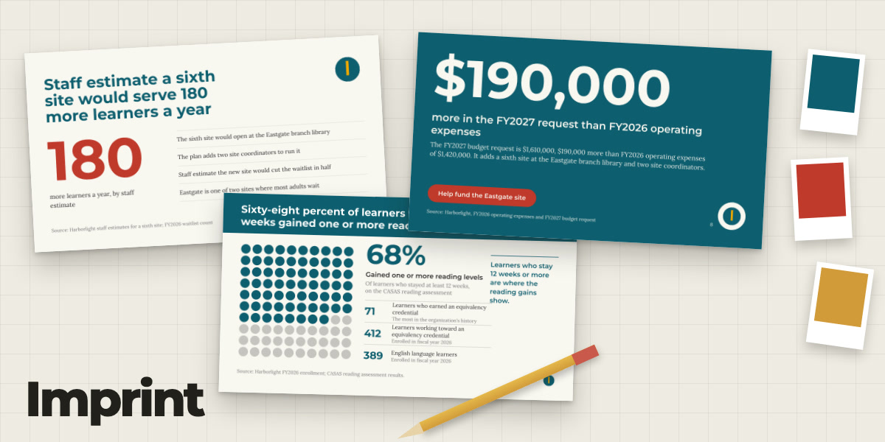
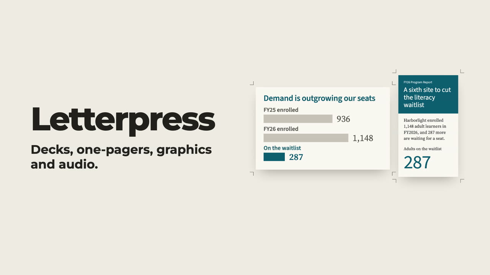
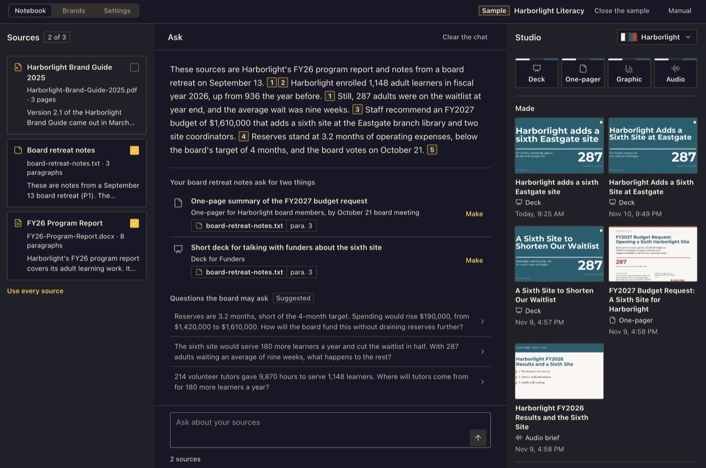
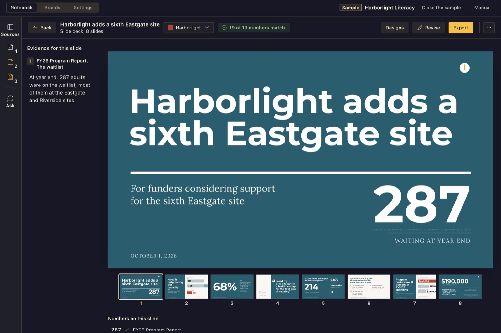
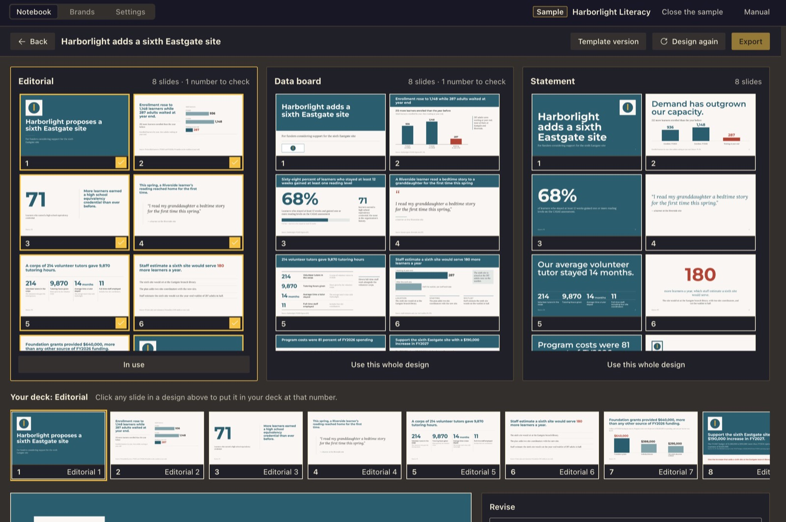

# Imprint



[](https://linchpin.studio/hermes/video/imprint.mp4)

**[Watch the 30-second demo](https://linchpin.studio/hermes/video/imprint.mp4)** · [Manual](https://linchpin.studio/hermes/imprint/manual/) · [All four plugins](https://linchpin.studio/hermes/)

Imprint turns your documents into a finished deck, one-pager, graphic or audio brief in your own brand, inside Hermes
Desktop. Drop in PDFs, Word files or text. Ask questions of your sources and get answers that cite the paragraph.
Pick from three deck designs, mix slides between them, and revise any slide in plain words. Before export, numbers and
quotes are checked against the sources, and the Source notes PDF shows each one beside the sentence it came from.

The writing and the checking use the model you already set up in Hermes. There is nothing else to sign up for.



The screenshots use the sample that ships with Imprint: Harborlight Literacy, a made-up adult literacy group.

## What it does

- **Sources.** Add a PDF, a Word file, a text or Markdown file, a transcript (.vtt, .srt, .txt), a web page or pasted
  text. Each becomes a card with a short summary. Tick the ones that count; everything else in Imprint uses only the
  ticked sources. Click a card to read every passage with its page, heading or timestamp. For audio or video, add the
  transcript.
- **Ask.** A chat that answers only from the ticked sources. Each claim carries a numbered mark that opens the passage
  it came from. Pin an answer as a note, copy it, or use **Make from this** to start a deck, one-pager or graphic from it.
- **Studio.** Four things to make: **Deck**, **One-pager**, **Graphic** and **Audio brief**. Fill in who it is for,
  what they should decide or do, and a length. A deck stops at an outline you can edit (retitle, reorder, delete, add,
  ask for three new titles) before anything is drawn.
- **Three designs.** When a deck, one-pager or graphic is finished, Imprint draws it three ways: Editorial, Data board
  and Statement. Your model lays out each one, looks at a picture of the result and fixes what is wrong. For a deck you
  can use one design whole, or pick slides from any of the three and mix them into one deck, then revise in words, edit
  a line, or go back to an earlier version. A **Template version** of every piece, set in the brand's own fixed
  layouts, is one click away.
- **Numbers are checked.** Every number and quoted phrase is matched against the passages it cites. A number that is
  not in your sources is flagged, and Export waits until you fix it, have your model fix it, or keep it on purpose.
  Hover a number to see the source sentence with the number marked. The check shows that a number appears in your
  sources, not that the source is right, and it checks numbers and quotes, not how a headline frames them. Read the
  headlines yourself.
- **Brands.** A brand is a saved set of colors (checked for contrast), fonts, a logo, voice rules, a page layout and
  rules for every page. Five studio brands ship with Imprint (Counsel, Chart Room, Stage, Folio and Meridian), plus 16
  earlier starters. Make your own by importing one (brand guide PDF, pasted color codes, CSS, an Open Design package, a
  Claude Design system, a PowerPoint or Canva file, a design tokens file, a logo or brand sheet, a Keynote theme on a
  Mac), by **Build from a website**, by **Help me build a brand** (your model proposes three that differ), or by hand.
  Every draft is shown as a proof before you save it.
- **Exports.** Deck: PDF and PowerPoint. The Template version exports a PowerPoint you can edit, with the brand on its
  slide master. A deck made from the three designs exports to PowerPoint as one picture per slide, with the slide's
  notes: you can present it but not edit its text. One-pager: PDF and PNG from the designs; PDF, a print proof with crop
  marks and a self-contained web page from the Template version. Graphic: PDF and PNG from the designs; PNG, SVG and
  PDF from the Template version. Audio brief: an MP3 recording, the script as text and a script PDF. Decks and
  one-pagers also export **Source notes**: a PDF that sets every number and quote beside the sentence in your sources
  it came from, grouped by slide, in your brand.





The full guide, with every screen, is the manual: https://linchpin.studio/hermes/imprint/manual/

## Requirements

- Hermes Desktop 0.22.6 or newer.
- A model set up in Hermes. If you've chatted with Hermes, you already have one; if not, open Hermes Settings, Model.
  Imprint uses your main model unless you set **Imprint writing** under Settings, Models, Auxiliary. Reading a logo or
  brand sheet needs a model that can see images.
- Google Chrome, Chromium, Microsoft Edge or Brave, for the three designs, for exporting a designed piece to PDF or
  PNG, and for reading how a website looks. Everything else works without one. Imprint finds an installed browser on
  its own; to use a different one, set the `IMPRINT_BROWSER` environment variable to its full path. Tested on a Mac.
  On Windows, Build from a website reads a site's colors and fonts but cannot yet look at the page in a browser.
- A voice set up in Hermes (text-to-speech), only if you want the audio brief recorded. The script is made either way.
- A few Python libraries (`pypdf`, `python-docx`, `python-pptx`, `reportlab` and `Pillow`), installed with the plugin.
  Hermes asks before it installs them.

## Install

From the Hermes plugin catalog:

```
hermes plugins install imprint
```

Or, in Hermes Desktop, open Capabilities, then Plugins, then Install from Git, and paste
`https://github.com/Dgardenhire/hermes-imprint`. Switch Imprint on under Capabilities, Plugins, then click **Imprint**
in the sidebar. It has three tabs: Notebook, Brands and Settings.

## Uninstall

1. If you want your Imprint data gone too, first open Imprint's **Settings** tab and use **Forget everything** (type the
   words it asks for). That deletes `<HERMES_HOME>/plugin-data/imprint/`: sources, brands, made pieces, recordings and
   settings. Files you exported are yours and stay where you saved them.
2. Remove the plugin. In Hermes Desktop: Capabilities, then Plugins, then the trash button beside Imprint, and confirm.
   From a terminal: `hermes plugins remove imprint`. Restart the gateway to unload its code.
3. Removing the plugin keeps its data folder. If you skipped step 1, delete `<HERMES_HOME>/plugin-data/imprint/`
   yourself. The Python libraries installed with it stay, since other plugins may use them.

## How long things take

How long a step takes depends on the model you use. Three designs take longer than one, because the model lays the
piece out three times and fixes each. They run side by side, and each shows its current step. You can leave the
screen while they draw. If a run is cut off (Hermes restarted, or you pressed Stop), it comes back as interrupted, and
**Design three options** or **Retry** starts it again.

## What leaves your computer

- Your ticked sources (with keys and passwords removed by Hermes), your questions, your brief and your notes go to the
  model you set in Hermes. If that model is a cloud service, the text goes to it.
- While drawing the three designs, Imprint shows your model a picture of each draft so it can fix it. A logo or brand
  sheet you ask Imprint to read also goes to your model as a picture.
- The audio script goes to your Hermes text-to-speech voice. If that is an online service (the Hermes default, Edge,
  is Microsoft's online voice), the script goes to it.
- A web address you add as a source is fetched by your Hermes web tool, or by Imprint itself if that tool is not set
  up. Only public web addresses are fetched.
- **Build from a website** fetches the page and its style sheets, and opens the home page and up to three pages it
  links to in a hidden browser with a fresh profile, read only. It respects the site's robots.txt and never types, clicks or signs
  in. Pictures of those pages and their style measurements go to your model.

Nothing else leaves: no usage data and no other servers.

## What Imprint touches on your computer

- **Files.** It saves only into `<HERMES_HOME>/plugin-data/imprint/` (or the folder in the `IMPRINT_DATA_DIR`
  environment variable, if you set one), into scratch folders it deletes afterward, and where you pick in the save
  dialog. A `debug.log` there keeps the last 200 lines of error kinds, never what you wrote. It reads only the files
  and folders you pick.
- **Other programs.** A browser runs in the background, with a throwaway profile, to draw the designs and their
  exports and to look at a website when you build a brand from one. On a Mac it also uses the built-in `sips` command
  to make a small preview of a one-pager. Each starts only when you press a button and ends with its job.
- **Keys and updates.** Imprint stores no keys or passwords and never updates itself.
- **Hermes tools it uses.** Your Hermes text-to-speech (`text_to_speech`), web tool (`web_extract`) and image tool
  (`image_generate`). The image tool has no button in the page; only a direct request to the plugin's own API can
  reach it.

## Brands, fonts and credits

- Use brands only for organizations you own or have permission to use.
- Imprint ships no third-party logos. Four of the earlier starter brands adapt color and type values from Open Design
  packages (Apache-2.0, with MIT upstreams; see `NOTICE`); they carry neutral names and no company's logo or mark. The
  US Web Design System starter follows a public domain design system (GSA's work is CC0, its fonts are OFL) and carries
  no logo, seal or government banner.
- Imprint never downloads a font. It uses the fonts it ships and the fonts you add to a brand, and refuses fonts whose
  license forbids embedding.
- Bundled fonts are under the SIL Open Font License 1.1 (`fonts/OFL.txt`): Anton, Barlow and Barlow Condensed, Courier
  Prime, Crimson Pro, DM Serif Display, Instrument Serif, Inter, Libre Caslon Display, Lora (The Lora Project
  Authors), Merriweather, Montserrat (The Montserrat Project Authors, Julieta Ulanovsky), Public Sans, Source Sans 3
  and Source Serif 4. `fonts/SOURCES.txt` records where each came from.
- Imprint is an independent plugin by Damon Gardenhire, not an official Nous Research plugin.

## For developers

```
cd tests && /usr/bin/python3 -m unittest discover -s .
node --test tests/js/*.test.mjs
node ../hermes-ui-kit/scripts/build.mjs .   # hermes-ui-kit checked out beside this repo
```

Changes: `CHANGELOG.md`.

## License

MIT License, Copyright (c) 2026 Damon Gardenhire. See [LICENSE](LICENSE). Bundled fonts and adapted brand values keep
their own licenses, listed in [NOTICE](NOTICE).
